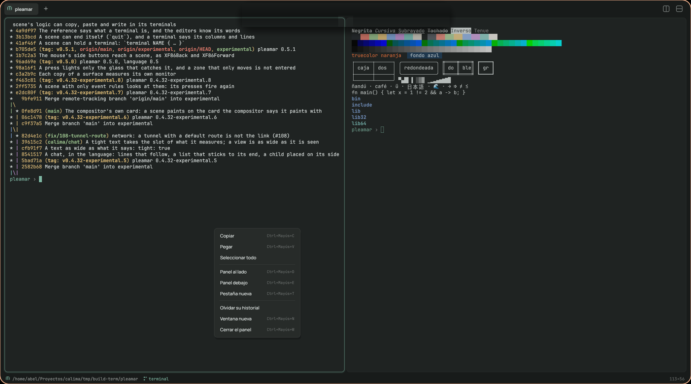

# Bitácora

**La terminal del escritorio de pleamar.** Pestañas con un glifo propio,
paneles al lado o debajo, los colores del escritorio, y una línea que dice
dónde estás y en qué rama.



La terminal en sí no está aquí: es el elemento `terminal` de
[pleamar](https://github.com/k4ditano/pleamar), un shell en su propia pty que
el motor pinta con sus propias letras (por debajo, el emulador de Alacritty y
Zed, `alacritty_terminal`). Bitácora es su ventana: una escena de pleamar
(`ui/bitacora.plm`) y su lógica (`ui/bitacora.luau`), metidas en un solo
binario con sus fuentes.

[Read in English](README.md)

## Qué hace

- **Pestañas** (seis como mucho), con el nombre de lo que corre en ellas o de su
  carpeta, y un glifo de cinco por cinco granos hecho con esa carpeta: la misma
  carpeta, el mismo glifo, la veas donde la veas.
- **Paneles** (cuatro por pestaña): al lado o debajo; el que tiene el teclado,
  con el borde en el acento del escritorio, y los demás un poco más tenues. Un
  shell que termina se lleva su panel; el último, la ventana.
- **Los colores del escritorio.** Con [Calima](https://github.com/k4ditano/calima)
  toma el acento, la superficie y la tinta del Taller, claro u oscuro, y los
  sigue cuando cambian; los dieciséis colores ANSI están afinados para cada uno.
- **La línea de abajo**: la carpeta del shell con el teclado, su rama de git, qué
  corre y cuántas columnas y líneas tiene.
- **Lo que hace una buena terminal**: colores de 16, 256 y 24 bits, negrita,
  cursiva y subrayados; las líneas de cajas y los bloques dibujados a mano para
  que encajen; seleccionar con el ratón (doble clic, una palabra; triple, la
  línea), Ctrl+Mayús+C y V, el botón central pega; la rueda por el historial;
  Ctrl+clic abre un enlace; los programas que quieren el ratón (vim, htop) lo
  tienen; y el cursor se desliza al escribir.
- **Los agentes la leen.** En una sesión de pleamar-wm sus shells pasan por la
  capa de terminales, así que `pleamar-wm agent` los lee y ejecuta órdenes en
  ellos como en cualquier otra terminal.

## Teclas

| | |
|---|---|
| Ctrl+Mayús+T | una pestaña nueva, en la carpeta de la que estás |
| Ctrl+Mayús+W | cerrar el panel (y la pestaña, con el último) |
| Ctrl+Mayús+D / E | un panel al lado / debajo |
| Alt+flechas | al panel de ese lado |
| Ctrl+Tab, Ctrl+Mayús+Tab, Ctrl+AvPág/RePág | la pestaña siguiente, la anterior |
| Ctrl+Mayús+C / V | copiar lo seleccionado / pegar |
| Mayús+RePág / AvPág | por el historial |
| Ctrl++ / Ctrl+- / Ctrl+= (Ctrl+Mayús+0 en un teclado español) | más grande, más pequeña, como estaba |
| Ctrl+Mayús+N | una ventana nueva |
| Ctrl+Mayús+F | buscar en su historial: Intro, la anterior; las flechas, arriba y abajo; Esc, terminar |

El botón derecho abre un menú con lo mismo, y con *Seleccionar todo* y
*Olvidar su historial*.

## Instalar

Necesita Rust y un pleamar con el elemento `terminal` (la rama `terminal`
hasta que salga en una versión).

```sh
git clone https://github.com/k4ditano/bitacora && cd bitacora
sh install.sh      # ~/.local/bin/bitacora, su entrada en las aplicaciones y su icono
```

`bitacora [CARPETA]` abre una ventana ahí (donde estés, si no se dice). Cada
ventana es su propio proceso: instalar una Bitácora nueva deja las abiertas
con sus shells.

## Trabajar en su aspecto

`BITACORA_UI_DIR=ui bitacora` lee la ventana del repositorio en vez de la copia
del binario, y la recarga al guardar `bitacora.plm` o `bitacora.luau`.

## Licencia

MIT. Sus fuentes son JetBrains Mono, Manrope y Newsreader, cada una con la SIL
Open Font License (en `ui/fonts`).
