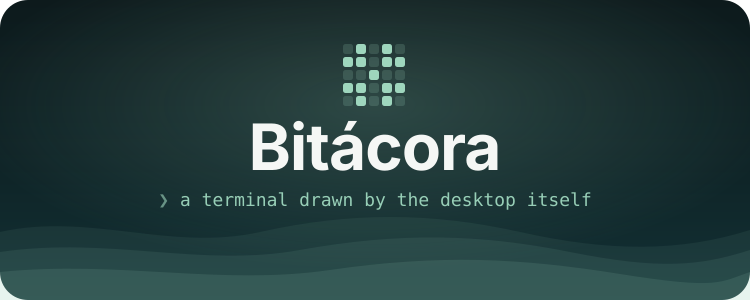
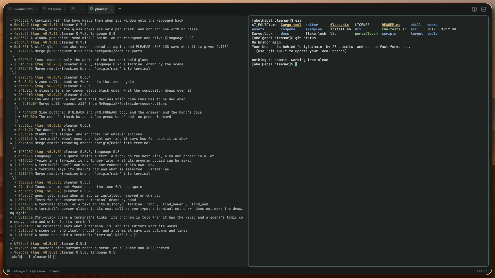
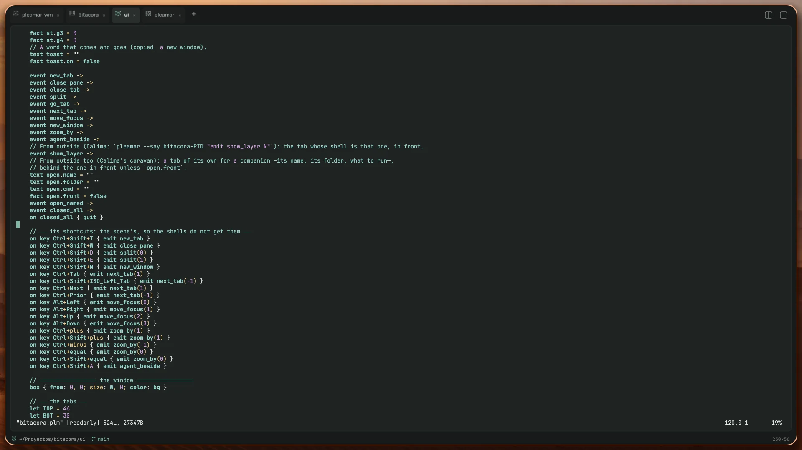

<div align = center>



<br>

[![Badge License]][License]
![Badge Language]
![Badge Commit]
[![Badge Issues]][Issues]
[![Badge Discord]][Discord]
[![Badge X]][X]
[![Badge Ko-fi]][Ko-fi]

<br>

The terminal of [pleamar]'s desktop: tabs with a glyph of their own, panes side
by side, the desktop's colours, and the agents that work in it, told apart at a
glance. A pleamar scene and a few hundred lines of Luau, in one binary.

<br>

---

**[<kbd> <br> Install <br> </kbd>][Install]**
**[<kbd> <br> Keys <br> </kbd>][Keys]**
**[<kbd> <br> With agents <br> </kbd>][Agents]**
**[<kbd> <br> pleamar <br> </kbd>][pleamar]**
**[<kbd> <br> pleamar-wm <br> </kbd>][pleamar-wm]**
**[<kbd> <br> Discord <br> </kbd>][Discord]**

---

<br>



<sub>pleamar's history, and a pane beside it. Each tab has a glyph made from its folder; the line under it all says where you are and on which branch.</sub>

<br>
<br>

</div>

# What it is

**The terminal itself is pleamar's.** pleamar has a `terminal` element: a shell
on a pty, drawn by the engine with its own letters, as sharp as any text of a
scene and in its colours (the emulator underneath is `alacritty_terminal`,
Alacritty's and Zed's). Bitácora is the window around it: a scene
(`ui/bitacora.plm`) and its logic (`ui/bitacora.luau`), carried inside one
binary with its fonts.

It runs on **any Wayland compositor**: Hyprland, Sway, niri, KDE, GNOME. Under
[pleamar-wm] it also knows which of its shells has an agent working, asking or
done (see [With agents](#with-agents)).

# Gallery

<div align = center>



<sub>vim in a tab, on its other screen, reading Bitácora's own scene. Programs that want the mouse get it.</sub>

</div>

# What it does

- **Tabs** (ten at most), each named after what runs in it or the folder it is
  in, with a glyph of five by five grains made from that folder: the same
  folder, the same glyph, wherever you see it.
- **Panes** (four a tab): beside or below, the one with the keys outlined in the
  accent, the others a little fainter. A shell that ends takes its pane with
  it; the last one, the window.
- **The line under it all**: the folder of the shell with the keys, its git
  branch, what runs and how many columns and lines.
- **The desktop's colours.** A shell that publishes its theme (accent, surface
  and ink, light or dark) is followed live, and the sixteen ANSI colours are
  tuned for each.
- **What a good terminal does**: 16, 256 and 24-bit colours, bold, italic and
  underlines; box lines and blocks drawn by hand so they meet; selecting with
  the mouse (two clicks a word, three a line), Ctrl+Shift+C and V, the middle
  button pastes; the wheel through the history and Ctrl+Shift+F to find in it;
  Ctrl+click opens a link; the other screen of vim and less; and the cursor
  leaves a faint trail as you type, never late.
- **Focus follows the mouse** where your window manager does: the terminal of
  the window under the pointer takes the keys, no click needed.

# With agents

In a pleamar-wm session Bitácora asks it every second about its shells
(`pleamar-wm term list --json`), and shows what it learns. Elsewhere it is a
plain terminal, without errors.

- **A tab with an agent** (Claude Code, Codex…) is named after its task, and a
  dot says how it is: breathing while it works, amber when it asks you
  something. One that finishes in a tab behind leaves a dot, as a bell does;
  the line under it all says «Claude · working».
- **An agent beside** (Ctrl+Shift+A): a pane beside the one you are in, with
  Claude in it (`BITACORA_AGENT` says another), and a wire between the two
  (`pleamar-wm term pair`), drawn as a knot of grains that carries a wave while
  something goes along it. For that agent your pane is one more window wired to
  its own: it reads it and runs things in it.
- **Send to…** (the right button): what is selected, as a letter to a named
  agent (`pleamar-wm link post`).
- **A whole team in one window.** `text open.name ID`, `text open.folder DIR`,
  `text open.cmd COMMAND` and `emit open_named` (through `pleamar --say
  bitacora-PID`) open a tab for a named agent, behind the one in front (`fact
  open.front true`: in front); asked again, its tab is brought forward. A shell
  can keep a whole team of agents in one window, one a tab.
- **Its tab, from outside.** Each window answers to `pleamar --say
  bitacora-PID`, and `emit show_layer N` brings forward the tab whose shell is
  pleamar-wm's layer `N`.
- **Agents read it.** Its shells go through pleamar-wm's layer of terminals, so
  `pleamar-wm agent` reads them and runs commands in them as in any terminal.

# Keys

| | |
|---|---|
| Ctrl+Shift+T | a new tab, in the folder of the one you are in |
| Ctrl+Shift+W | close the pane (and the tab, with its last one) |
| Ctrl+Shift+D / E | a pane beside / below |
| Alt+arrows | to the pane that way |
| Ctrl+Tab, Ctrl+Shift+Tab, Ctrl+PageDown/Up | the next tab, the one before |
| Ctrl+Shift+C / V | copy what is selected / paste |
| Shift+PageUp / PageDown | through the history |
| Ctrl++ / Ctrl+- / Ctrl+= | bigger, smaller, as it was |
| Ctrl+Shift+N | a new window |
| Ctrl+Shift+F | find in its history: Enter, the one before; the arrows, up and down; Esc, done |
| Ctrl+Shift+A | an agent beside, wired to the pane you are in |

The right button opens a menu with the same, and with *Select all*, *Send
to…* and *Forget its history*.

# Install

It needs Rust (stable) and a Wayland session; pleamar comes with it, as a
dependency fetched by Cargo.

```sh
git clone https://github.com/k4ditano/bitacora && cd bitacora
sh install.sh      # ~/.local/bin/bitacora, its entry among the applications and its icon
```

`bitacora [FOLDER]` opens a window there (where you are, if not said);
`bitacora -e COMMAND …` runs that instead of a shell, and closes with it. Each
window is its own process: installing a new Bitácora leaves the open ones with
their shells.

Bind it to a key in your compositor: in Hyprland, `bind = SUPER, Return, exec,
bitacora`; in pleamar-wm, `bind Super+Return launch bitacora` in `keys.conf`.

### Working on its look

`BITACORA_UI_DIR=ui bitacora` reads the window from the repository instead of
the copy in the binary, and reloads it when `bitacora.plm` or `bitacora.luau`
is saved: it is a pleamar scene like any other.

# Special Thanks

**[Alacritty]** - *For `alacritty_terminal`, the emulator underneath*

**[pleamar]** - *For the `terminal` element and everything around it*

# License

Bitácora is under the [MIT License][License]. Its fonts are JetBrains Mono,
Manrope and Newsreader, each under the SIL Open Font License (in `ui/fonts`).

[Leer en español](LEEME.md)

Made by **[@k4ditano][X]** — come and say hi, ask or show what you made on
**[Discord]**. If it makes your desktop nicer, you can **[buy me a coffee on
Ko-fi][Ko-fi]** ☕

<!----------------------------------------------------------------------------->

[Install]: #install
[Keys]: #keys
[Agents]: #with-agents
[pleamar]: https://github.com/k4ditano/pleamar
[pleamar-wm]: https://github.com/k4ditano/pleamar-wm
[Alacritty]: https://github.com/alacritty/alacritty
[License]: LICENSE
[X]: https://x.com/k4ditano
[Discord]: https://discord.gg/N7kbYC49b2
[Ko-fi]: https://ko-fi.com/k4ditano
[Issues]: https://github.com/k4ditano/bitacora/issues

<!----------------------------------{ Badges }--------------------------------->

[Badge License]: https://img.shields.io/badge/license-MIT-9ed6bd?style=flat-square
[Badge Language]: https://img.shields.io/badge/made%20with-pleamar%20%2B%20Luau-2c7684?style=flat-square
[Badge Commit]: https://img.shields.io/github/last-commit/k4ditano/bitacora?style=flat-square&color=9ed6bd
[Badge Issues]: https://img.shields.io/github/issues/k4ditano/bitacora?style=flat-square&color=2c7684
[Badge Discord]: https://img.shields.io/badge/chat-Discord-5865f2?style=flat-square&logo=discord&logoColor=white
[Badge X]: https://img.shields.io/badge/follow-@k4ditano-000000?style=flat-square&logo=x
[Badge Ko-fi]: https://img.shields.io/badge/support-Ko--fi-ff5e5b?style=flat-square&logo=ko-fi&logoColor=white
